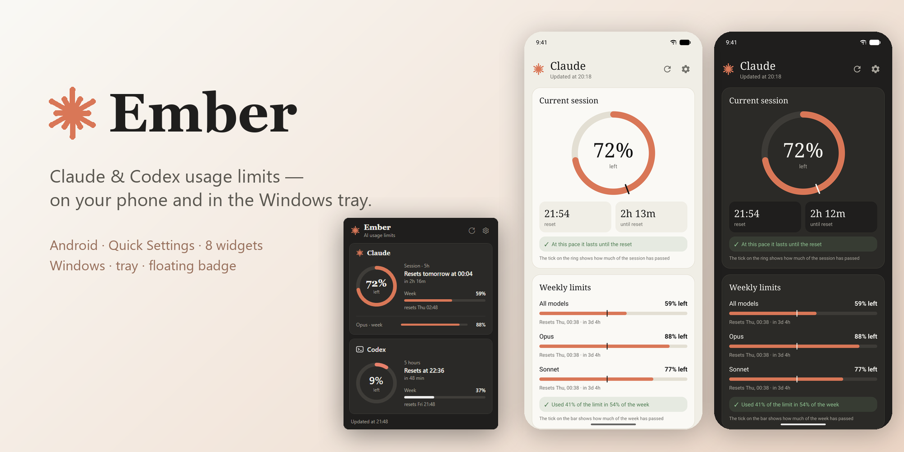
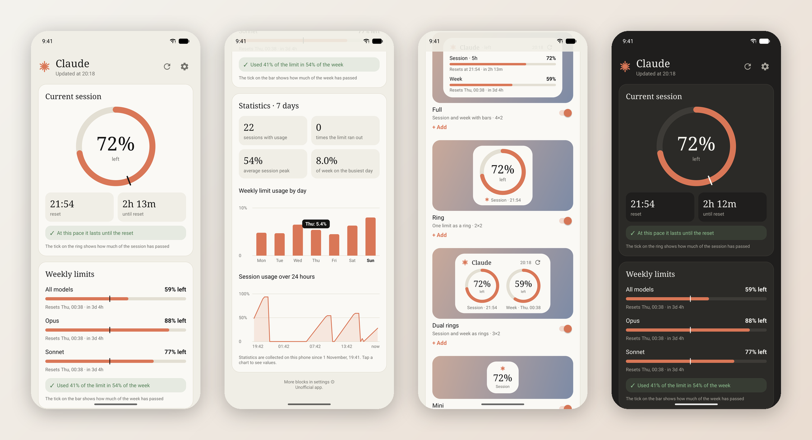
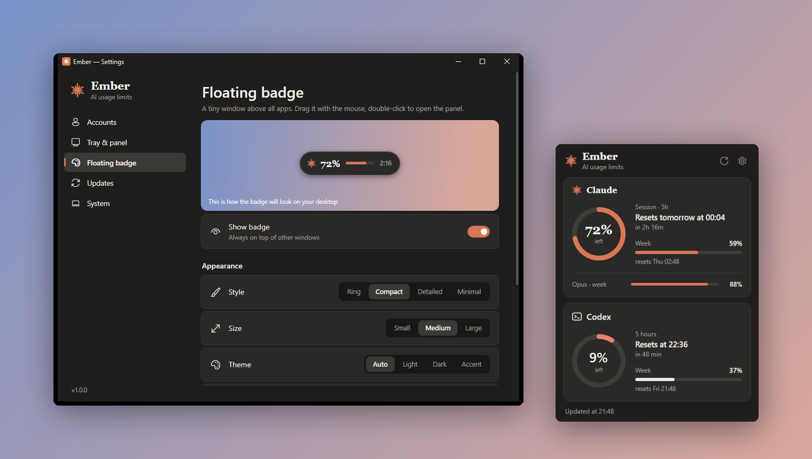
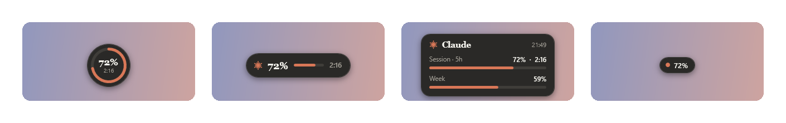
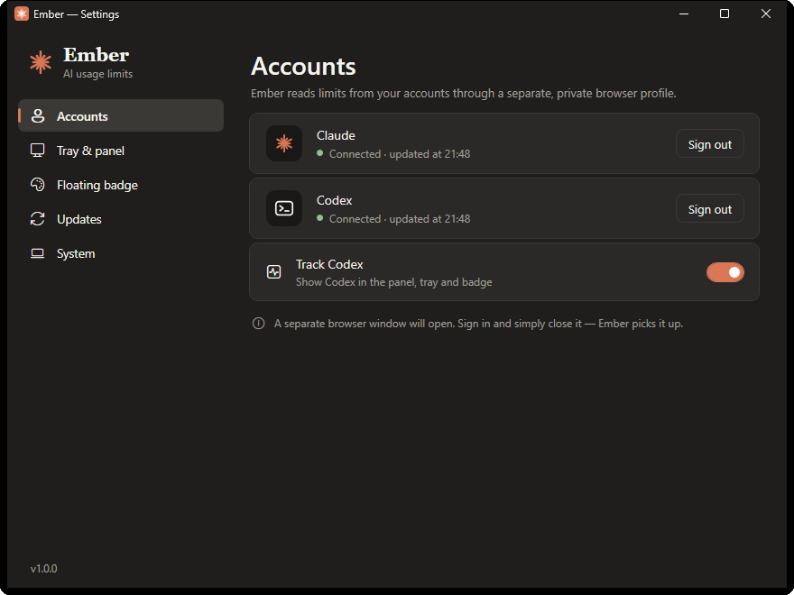
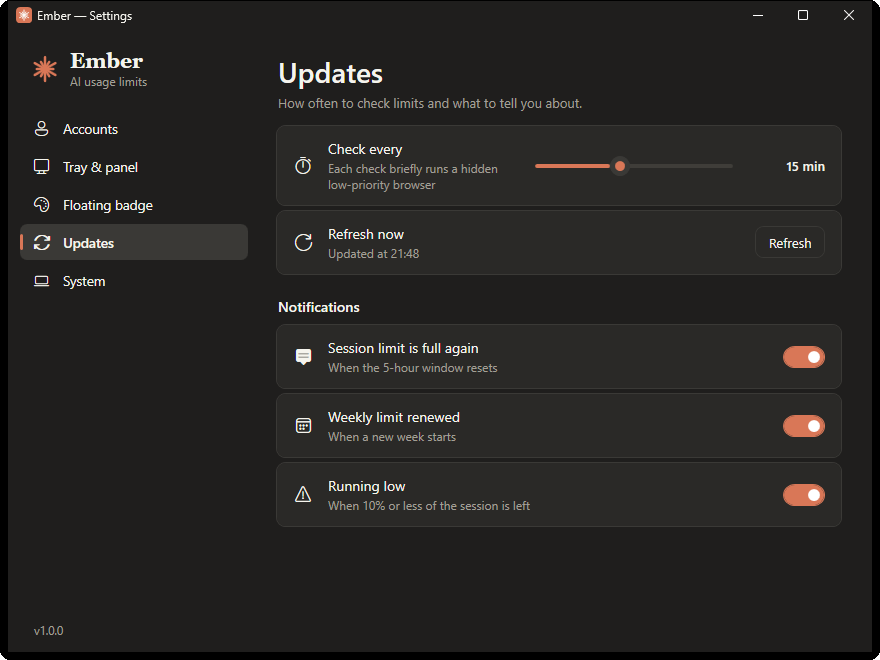
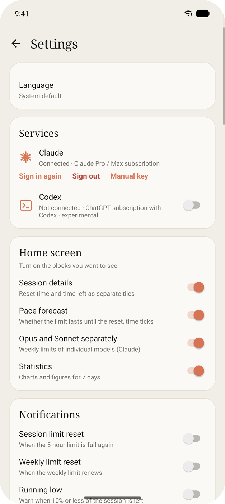
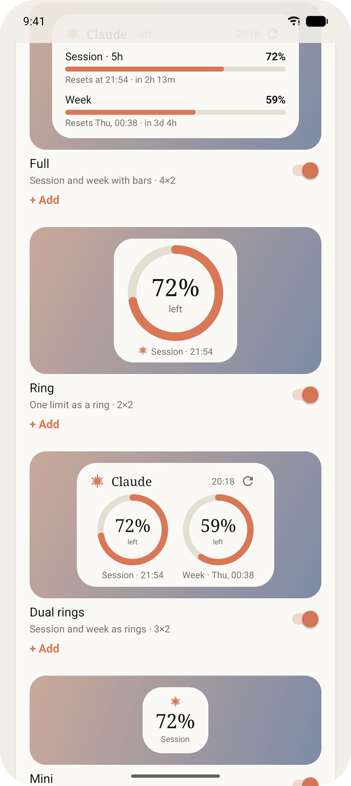
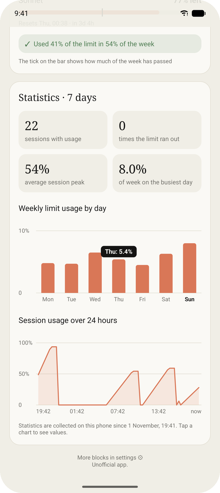
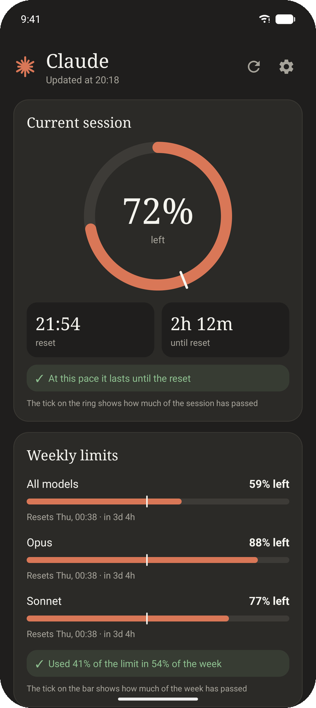

<p align="center">
  
</p>

<h1 align="center">Ember</h1>

<p align="center">
  <b>See how much of your Claude and Codex limits is left — at a glance.</b><br>
  A tiny Android app with widgets and Quick Settings tiles, and a Windows tray app with a floating badge.
</p>

<p align="center">
  <a href="../../releases/latest"></a>
  
  
  
</p>

<p align="center">
  <a href="#android">Android</a> ·
  <a href="#windows">Windows</a> ·
  <a href="#download">Download</a> ·
  <a href="#how-it-works">How it works</a> ·
  <a href="#build-from-source">Build</a> ·
  <a href="#українською">Українською</a>
</p>

---

## Android

<p align="center"></p>

- **Session and weekly limits** — the 5-hour session, the weekly limit and separate Opus / Sonnet limits, with exact reset times.
- **Pace forecast** — a tick on every ring and bar shows how much of the window has passed, so you know whether the limit will last until the reset.
- **Statistics** — usage by day for the last week and a 24-hour session chart, collected on the phone.
- **9 home-screen widgets** — full, ring, dual rings, mini, countdown, strip, statistics, an all-services overview and **Custom**. Each one adapts to its size and can be customized; live previews in settings show exactly what you are adding.
- **Custom widget** — build your own: pick and reorder blocks (session, week, Opus, Sonnet, countdown, 7-day chart, update time), show limits as rings, bars or big numbers, choose background and accent colors, gradient, outline, font, text size, corner radius and line thickness. On wide widgets the content flows into two columns.
- **4 Quick Settings tiles** — check your limit without opening anything.
- **Reset notifications** — when the session is full again, when the week renews, and when you are running low.
- **Native look per service** — Claude's warm cream and terracotta, or ChatGPT's black and white for Codex. Light and dark themes, edge-to-edge on modern Android.
- **5 languages** — English, Ukrainian, Polish, German, Spanish (follows the system or pick in settings).
- **Light** — about 200 KB, no third-party libraries, no ads, no tracking.

## Windows

<p align="center"></p>

- **Tray icon with a number** — the percentage left (or used) right next to the clock, with a ring that turns red when you are running low.
- **Flyout panel** — click the tray icon for a Windows 11-style panel with every connected service.
- **Floating badge** — a small always-on-top widget you can drag anywhere. Four styles, three sizes, light / dark / accent themes, adjustable opacity, lock in place.

<p align="center"></p>

- **Notifications** for resets and low limits, **auto-start** with Windows, Ukrainian and English.
- **Doesn't get in the way** — 0% CPU when idle, about 40 MB of RAM with the windows closed. A check briefly runs a hidden low-priority browser and closes it right away.

<details>
<summary>More screenshots</summary>
<br>
<p align="center">
  
  
</p>
<p align="center">
  
  
  
  
</p>
</details>

## Download

Grab the files from the [latest release](../../releases/latest):

| File | For |
|---|---|
| `Ember-…-android.apk` | Android 8.0 or newer |
| `Ember-…-windows-x64.exe` | Windows 10 / 11 — works out of the box |
| `Ember-…-windows-x64-net10.exe` | Same app, 0.5 MB, needs the [.NET 10 Desktop Runtime](https://dotnet.microsoft.com/download/dotnet/10.0) |

**Android:** open the APK and allow installing from your browser or file manager. On first launch pick a service and sign in.

**Windows:** run the `.exe` — there is nothing to install. Open settings and click **Sign in** next to Claude; a separate browser window opens, sign in and simply close it. Windows 11 hides new tray icons under the **^** arrow — drag Ember's icon onto the taskbar to always see the number.

## How it works

Ember shows the same numbers you see on the usage page of claude.ai (and the Codex usage page in ChatGPT). It reads them from your own signed-in session:

- **Android** — you sign in once inside the app; requests are made through the system WebView with your session cookie.
- **Windows** — you sign in once in a separate, private Microsoft Edge (or Chrome) profile that only Ember uses. Every check opens that profile headless for a few seconds, reads the numbers and closes it.

Your session and the numbers never leave your device. There is no server, no analytics and no account other than your own. Signing out deletes the stored session.

> Ember uses the same internal endpoints as the official websites. They are not a public API and may change at any time — if something breaks, please open an issue.

## Build from source

**Android** — JDK 17+, Android SDK 36:

```bash
cd android
./gradlew assembleRelease
```

Release signing is read from `android/keystore.properties` or `~/.ember-keys/keystore.properties` (`storeFile`, `storePassword`, `keyAlias`, `keyPassword`); without it the build is signed with the debug key.

**Windows** — [.NET 10 SDK](https://dotnet.microsoft.com/download/dotnet/10.0):

```bat
build.cmd
```

or `dotnet publish windows/Ember.csproj -c Release -o out`.

## Project structure

```
android/   Kotlin app — no third-party dependencies
windows/   WPF app (.NET 10) — tray, panel, floating badge, settings
docs/      screenshots
```

## Disclaimer

Ember is an independent, unofficial project. It is not affiliated with, endorsed by or sponsored by Anthropic or OpenAI. "Claude" is a trademark of Anthropic; "ChatGPT" and "Codex" are trademarks of OpenAI.

## License

[MIT](LICENSE)

---

## Українською

**Ember** показує, скільки ще лишилося лімітів Claude і Codex.

- **Android** — головний екран із кільцем сесії, тижневими лімітами й прогнозом темпу; статистика; 9 віджетів для робочого столу, зокрема повністю налаштовуваний «Свій»; 4 плитки в швидких налаштуваннях; сповіщення про скидання лімітів; світла й темна теми; 5 мов.
- **Windows** — число відсотків у треї, панель у стилі Windows 11 і плаваючий значок поверх усіх вікон (4 стилі, розміри, теми, прозорість).

**Як встановити:** завантажте файли з [останнього релізу](../../releases/latest). На Android відкрийте APK. На Windows просто запустіть `.exe`, відкрийте налаштування й натисніть **«Увійти»** біля Claude, увійдіть у вікні браузера, яке відкриється, і закрийте його.

Дані беруться з вашого власного акаунта й нікуди не надсилаються — усе зберігається лише на вашому пристрої. Це неофіційний застосунок, не пов’язаний з Anthropic чи OpenAI.
